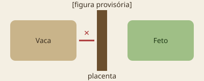

---
# Slides 1 (título), 3 (destaques), 6 (pontos-chave), 7 (teste) e 8 (agradecimentos)
# são gerados a partir destes dados. Você escreve só o miolo, abaixo.
destaques:
  - Por que a bezerra depende do colostro
  - O que é o fechamento intestinal
  - Como medir a qualidade do colostro
  - Como confirmar se a bezerra ficou protegida
duracaoMin: 20
quiz:
  multipla:
    pergunta: Por que a bezerra nasce sem anticorpos?
    opcoes:
      - Porque a vaca não produz anticorpos durante a gestação
      - Porque a placenta da vaca não deixa os anticorpos passarem para o feto
      - Porque os anticorpos são destruídos durante o parto
    correta: 1
    explicacao: A placenta dos bovinos impede a passagem de imunoglobulinas — a proteção vem só pelo colostro.
  praticas:
    - Uma bezerra nasceu de madrugada e só foi encontrada às 10h. O que você faria, e em que ordem?
    - Como você organizaria um banco de colostro congelado numa propriedade sem freezer próprio?
---

## Por que isso importa?

- A bezerra nasce **sem imunidade própria**
- O colostro é a única fonte de anticorpos nas primeiras semanas
- Falhas aqui aparecem depois como diarreia, pneumonia e morte

Note:
Comece perguntando à turma quantos já viram uma bezerra "fraca" nos primeiros dias.

---

## A placenta como barreira

A placenta dos bovinos não permite a passagem de imunoglobulinas.

---

## O relógio do intestino

- Nas primeiras horas, o intestino absorve anticorpos inteiros
- A absorção cai rapidamente
- Por volta de **24 h**: fechamento intestinal

---

## Medindo a qualidade

| Leitura Brix | Interpretação |
|---|---|
| ≥ 22% | Boa qualidade |
| < 22% | Qualidade baixa — complementar |

<!-- TODO: conferir limiares com a referência -->

---

## Protocolo de fornecimento

1. Ordenhar a vaca logo após o parto
2. Medir com o refratômetro
3. Fornecer o volume calculado
4. Registrar tudo na ficha
